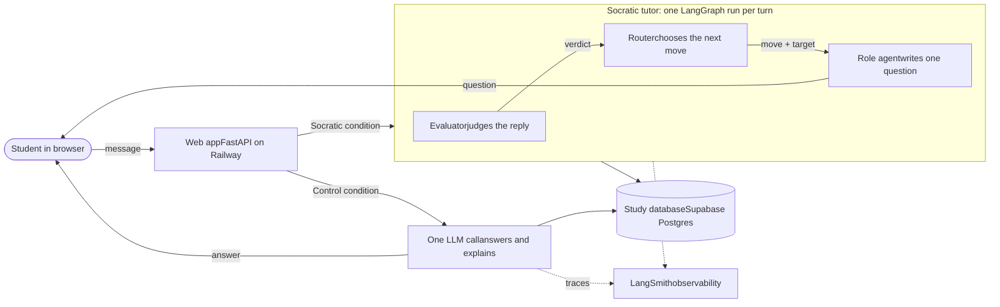
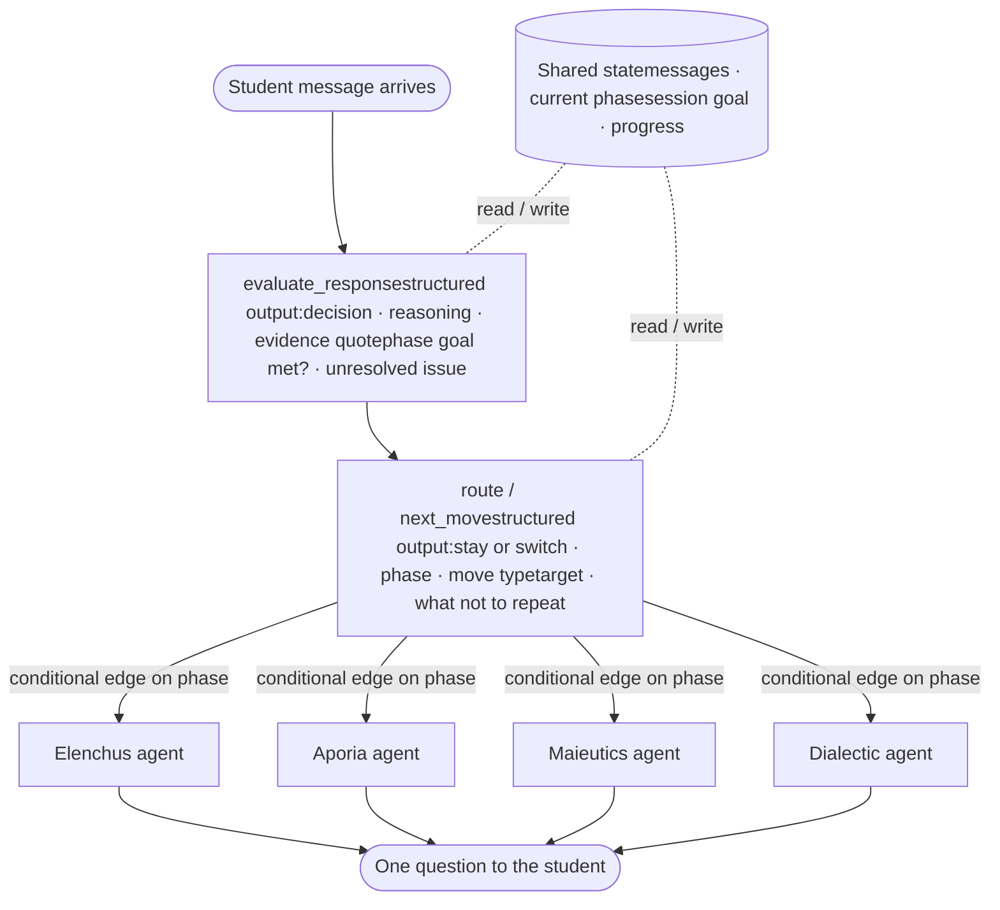

Teaching notes · agentic AI in practice

# A Socratic tutor built from cooperating agents

How the tutor in our multi-university study decides what to ask next, and which agentic AI ideas it uses. No student data appears on this page.

## The idea in one paragraph

A normal chatbot is one model call per message: the student asks, the model answers. Our Socratic tutor splits each turn into jobs and gives each job to a separate agent. One agent **judges** the student's reply, a second **plans** the next move, and a third **writes** a single question in a specific questioning style. The agents share a state that persists across the conversation, so the tutor remembers what the student has already shown and what is still unresolved. The study compares this design with a standard one-call assistant on the same scenarios.

## System architecture

Both conditions run behind the same web app and log every turn, with timing, token counts and prompt versions, so the two can be compared fairly.

## One Socratic turn as a LangGraph graph

Simplified for teaching. Each node reads and updates a shared state object; the router's decision picks which role agent runs, which is a conditional edge in LangGraph terms.

## The four role agents

Each role agent has its own prompt and does one kind of Socratic questioning. The router decides which one speaks next.

### Elenchus

cross-examination

Tests a claim: asks for the reason behind it, or points out a tension with something the student said earlier.

### Aporia

productive puzzlement

Helps a student who is stuck see exactly what is unresolved, without supplying the answer.

### Maieutics

"midwifery"

Draws out an idea the student is close to, so they state it in their own words.

### Dialectic

weighing positions

Sets two views or cases side by side and asks the student to compare and decide.

## Agentic AI ideas students can see here

| Concept | Where it appears in the tutor |
| --- | --- |
| Task decomposition | One turn is split into judge, plan and write, each a separate agent with a narrow job and its own prompt. |
| Graph orchestration | LangGraph wires the agents as nodes with edges, instead of one long prompt trying to do everything. |
| Shared state | A state object carries the conversation, the current phase and what is unresolved, so every agent works from the same memory. |
| Conditional routing | The router's decision selects which role agent runs next. The path through the graph changes with the student's answer. |
| Structured outputs | The evaluator and router return typed fields (decision, evidence quote, target), not free text, so later steps and researchers can rely on them. |
| Agent as judge | The evaluator is an LLM grading another participant's reasoning against criteria, a pattern now common in AI evaluation. |
| Guardrails outside the model | Minimum session length, timers and answer rules are enforced by the server, not left to the model to remember. |
| Observability | Every model call is traced in LangSmith, and every verdict and routing decision is stored, so behavior can be audited later. |
| Reproducibility | Each logged turn records the model, prompt version and a fingerprint of the prompt text. |

## Same student message, two designs

### Socratic tutor

Three agents per turn. Asks one question, never states the conclusion, and pushes on the weakest part of the reasoning.

### Standard assistant

One call per turn. Answers, explains and recommends, staying within the scenario.

## Questions for discussion

- What does splitting judging, planning and writing into separate agents buy you, compared with one carefully written prompt? What does it cost in speed and money?
- The evaluator is an LLM judging a student. How would you check that its judgments are reliable?
- Which rules should live in code (timers, minimum length) and which can be left to the model? Why?
- Students sometimes rated the Socratic tutor as less helpful even when it made them think harder. How should a product team weigh user satisfaction against learning?
- What would you log so that a reviewer could reconstruct exactly why the tutor asked a particular question?